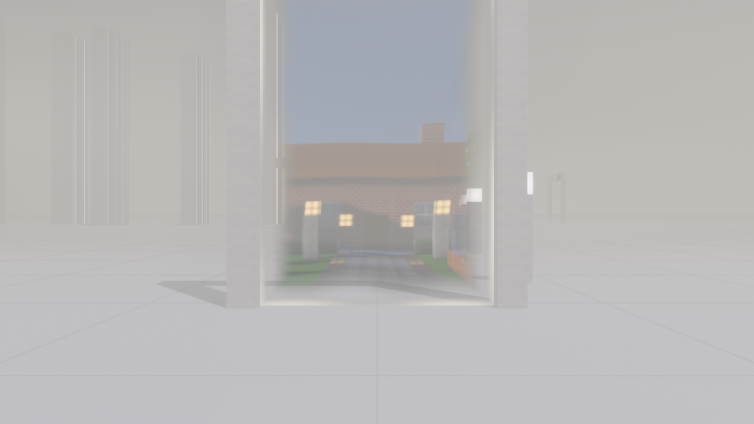
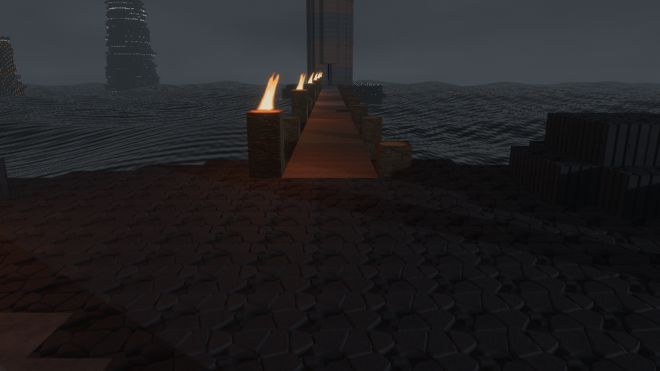
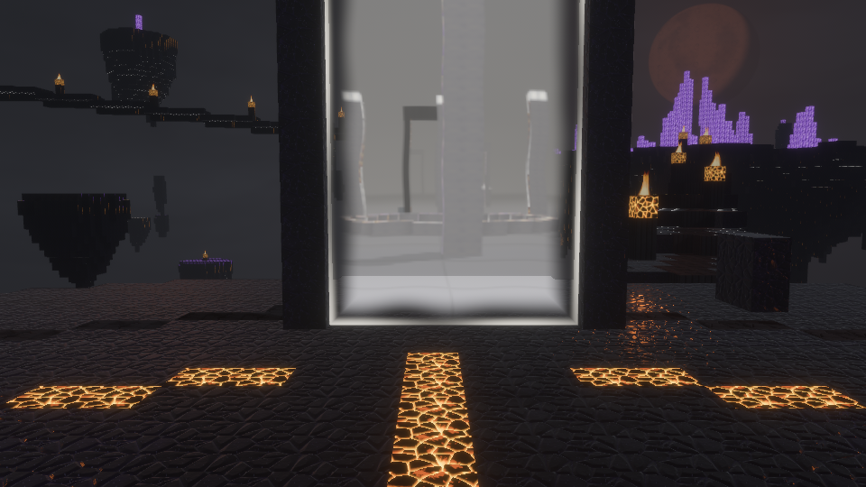
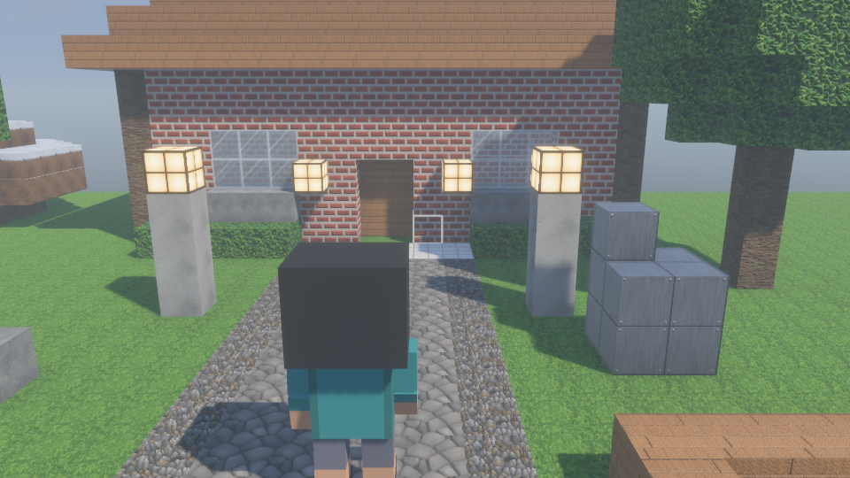
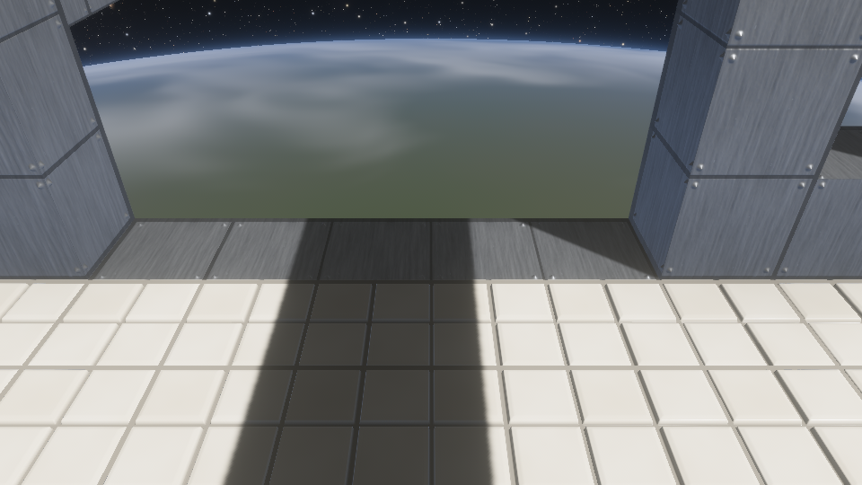
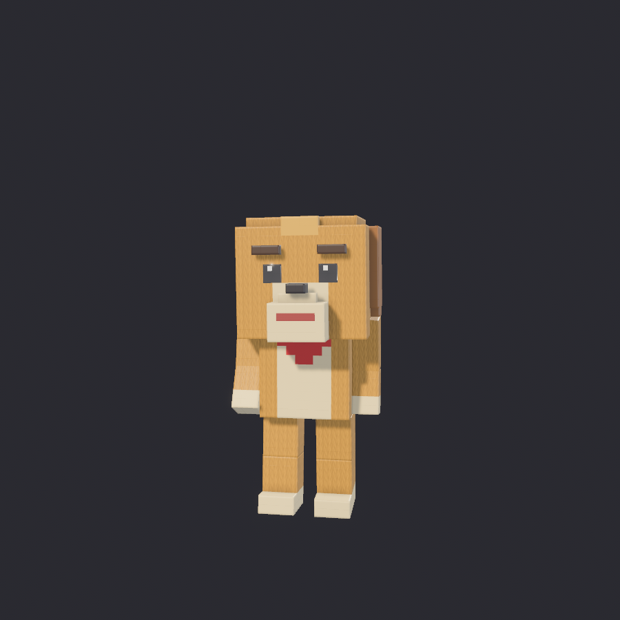

# Vox

A shared world built from blocks that you walk into from a link. Sign in, make a block
character, and step into worlds you build in together: the same Rust client runs on the desktop
and in a browser tab, so whoever you send the link to is standing next to you seconds later. Live
at https://vox.fail. This repository also holds **Block Avatar**, a mic-driven avatar app for
streams, built from the same characters and blocks, so a stream's audience can follow the
streamer into a world.



## Why Vox

Building together in a world of blocks is one of the largest audiences in games, and two closed
platforms own it: Roblox had 123 million daily users in Q2 2026, and Minecraft 155 million
monthly users at Microsoft's last count (October 2025). Both ask for an install and an account
before anyone can join. Vox goes after the moment before that: someone shares a link, often
during a live stream, and the viewer is in the world in a browser tab, building next to the
person who sent it. Demand for new voxel worlds is not used up either: Hytale passed a million
players in the first days of an unfinished early access in January 2026.
([Sources](#sources).)

## What makes it different

**One client, desktop and browser.** The game is Rust and Bevy, compiled natively and to
WebAssembly from one codebase, with the rules in an engine-free crate both share. The browser
isn't a cut-down port: a link opens the real game.

**Worlds joined by doorways.** Portals show the world on the other side, and walking through
hands you to that world's server with a one-use ticket. Raid parties get their own
copies of dungeons, and atlases tile generated ground into large maps whose edges are portals.



**Worlds that feel alive.** A weather model on the server (fog, rain, wind) is sent to every
player; the sea rolls in swells under a gale; fires, waves and rain each move to their own noise;
natural ground dips a few centimetres where the world's seed says so. The stormy sea holds a
steady 60 fps on an integrated laptop GPU in the desktop client.



**The server is the authority, and costs nothing when empty.** Every edit is ordered by the
server; clients predict with the same rule code, and impossible moves are corrected. Many worlds
share one process and port: a world starts on its first visitor and stops when the last one
leaves. Sign-in tokens are checked offline, so worlds run anywhere without calling home.

**History you can go back through.** Worlds are saved as content-addressed 256 m zones grouped
into 8 km regions. A snapshot every five minutes shares everything unchanged, and the last week
is kept (in a folder or as Oxen commits), so a world can be rolled back to any moment in it.
Builds have an owner and separate rights to use, copy and edit them.



**Voice where you stand.** Talk to whoever is nearby (it fades with distance and pans to where
they are) or to your raid party anywhere, relayed by the world server at about 76 kbit/s a
voice. Only real voices: no synthetic voices and no voice changers.



**Block Avatar, for streams.** A desktop app that drives a block character from the microphone
(lip sync, laughter and singing, reactions), takes Twitch chat and recorded viewer questions, and
outputs to OBS. The characters are the same ones that walk in Vox worlds.



The pictures are made by the game itself: `tools/dev/screenshots.sh` starts each world from its
level file and has the real client draw it from a set view into `docs/screenshots/`. Run it when
the look of the game changes and commit the pictures with that change. (The Block Avatar picture
is a visual-test reference, refreshed with `tools/test/visual_test.py --update`.)

## Quick start: walk around in Vox

```bash
tools/dev/play-local.sh                                    # five local worlds, then the client in the Void
tools/dev/play-local.sh --name Sam --model models/dog.glb  # your name and character
```

That builds in release mode (the first build compiles Bevy and takes several minutes), starts
the Void, the yard, the islands, the Dark Sea and orbit locally with guests allowed, and opens the
client in the Void. Click to look round, WASD to walk, left click breaks, right click places, E
for every block, hold Tab for the quick wheel, Esc for the menu; a controller works too, with its
own button hints. Walk into a doorway to cross to another world. If a port is taken by a leftover
server, `pkill vox-server`.

## What's here

| Folder | What |
| --- | --- |
| `crates/vox-core` | The rules every part shares, with no engine: blocks and chunks, edits, raycasts, walking physics, levels, the wire protocol, sign-in tokens, weather, generated ground and relief |
| `crates/vox-world` | A world on screen (Bevy): meshing, sky, portals, the server link, input actions, HUD, menus, voice |
| `crates/vox-format` | The world format: zones as compressed, content-addressed blobs; regions; snapshots kept a week, in a folder or Oxen |
| `crates/vox-voice`, `crates/avatar-voice` | Voice chat's codec and packets; Block Avatar's voice analysis (lip sync, laughter, singing) |
| `bins/vox-client` | The player client, on the desktop and (as WebAssembly) in the browser |
| `bins/vox-server` | One world server |
| `bins/vox-host` | Many worlds in one process on one port, started on demand, and raid parties' dungeon copies |
| `bins/vox-directory` | Accounts, characters, the economy, the web pages' API |
| `bins/vox-relay` | Relays network shows for the avatar app |
| `bins/block-avatar` | The streaming avatar app |
| `apps/site` | The vox.fail pages (React, Mantine, Bun) |
| `assets/`, `data/` | Models, props, sets, sounds, fonts; blocks, characters, wardrobe, levels |
| `tools/assets`, `tools/dev`, `tools/test` | Asset builders; dev scripts (local play, the browser build, the README's screenshots); test drivers |
| `deploy/` | systemd units and the Cloudflare Tunnel for vox.fail; a container image and Helm chart |
| `docs/` | `help/` (player help), `vox/` (playing and running worlds), `avatar/` (the avatar app's manual), `design/` (design documents), `screenshots/` (the pictures above) |

## Building

```bash
cargo build --workspace          # every Rust crate (a bare `cargo build` does too)
cargo test --workspace
bun install                      # the web apps' dependencies
(cd apps/site && bun run build)  # the pages, into apps/site/dist
tools/dev/build_web.sh           # the browser client, into apps/site/public/pkg
tools/dev/screenshots.sh         # the README's pictures, into docs/screenshots
```

On Linux, install the audio and input headers first: `sudo apt install libasound2-dev libudev-dev`
(Debian and Ubuntu) or `sudo pacman -S alsa-lib systemd-libs` (Arch).

## How we track work

- **GitHub Issues** are for people: bugs, feature requests and questions from users and contributors.
- **[beads](https://github.com/steveyegge/beads)** (`bd`) is for agents: task breakdowns, dependencies
  and follow-ups, each referencing its GitHub issue (`gh-42`). Users never need it.
- **[okf](https://github.com/okf-memory/okf-agent-memory)** keeps long-term project knowledge in
  `knowledge/` (architecture, technologies, decisions, status). An MCP server is set up in
  `.mcp.json`; the rules for agents are in [AGENTS.md](AGENTS.md).

## Read next

- [docs/help](docs/help/README.md): player help: getting started, controls, building, worlds,
  accounts, troubleshooting, FAQ. Also on the site at /help.
- [docs/vox](docs/vox/README.md): running worlds, the directory, signing in, authority, plots,
  portals, raids.
- [docs/avatar/manual.md](docs/avatar/manual.md): Block Avatar, the streaming app.
- [deploy/README.md](deploy/README.md): how vox.fail is deployed.
- [docs/design](docs/design): world scaling, the world format, worlds joined by portals, ground
  relief, props, controls and HUD, the repository layout.
- [AGENTS.md](AGENTS.md): for contributors and AI agents: layout, commands, conventions.

## Sources

Market figures are third-party, as of November 2026, and vary by method.

- Roblox Q2 2026 users and bookings: [Nasdaq, Q2 2026 earnings call highlights](https://www.nasdaq.com/articles/roblox-q2-earnings-call-highlights).
- Minecraft's 155M monthly users (Microsoft, October 2025): [DemandSage, Minecraft statistics](https://demandsage.com/minecraft-statistics/).
- Hytale's early access: [Notebookcheck, over a million players](https://www.notebookcheck.net/Hytale-s-Early-Access-surges-past-1-Million-players-as-19-99-sandbox-RPG-returns-from-the-brink.1206095.0.html); [Massively Overpowered, launch on January 13, 2026](https://massivelyop.com/2026/01/13/hytale-has-officially-opened-its-early-access-to-hungry-pixel-mmo-players-today/).
