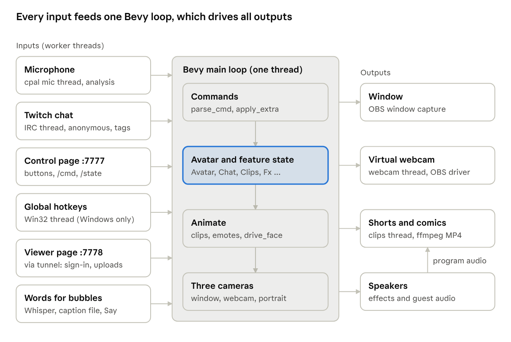

# Block Avatar — Project and Product Document

Nov 22, 2026 · @John Bellone

## How to use this document

This is the reference for an independent review of Block Avatar: a Rust/Bevy desktop app that turns a streamer's voice and Twitch chat into an animated voxel character. Read it alongside the source in `block-avatar.zip`. Every claim here should be checkable against a file named in the text.

**What the reviewer is asked to do**

1. Check the design for correctness, security and maintainability, using the architecture and module sections.
2. Read the security section and the HTTP surfaces in `src/control.rs` and `src/ask.rs`. These are the only parts reachable from outside the machine.
3. Check the Windows-only code (`src/hotkeys.rs`, `src/applog.rs`, `installer/`, `.github/workflows/windows.yml`). It has been type-checked but never run.
4. Answer the questions in the review checklist, and add any risks the known-issues list misses.

**Conventions.** Paths are relative to the project root. "Command" means a control-page command string such as `throw:tomato`. "User folder" means where settings, clips and logs are written (see Build and distribution). Line counts and test counts are as of the date above.

**Scope.** Everything in the repository as of 2026-11-22: 56 passing unit tests, with polish items P1 to P4 complete. Live Twitch, a real GPU, Windows and Whisper transcription have not been exercised; the testing section lists exactly what was.

## Product overview

Block Avatar is a single desktop program. It shows one of 37 voxel ("block") characters that talks when you talk, reacts to your voice and to Twitch chat, and records its best moments as vertical shorts. It is aimed at solo streamers and video makers who want a characterful on-screen persona without a face camera, a VTuber rig or a production crew.

**The problem it solves.** VTuber tools need a webcam for face tracking, a 2D or 3D rig, and OBS plug-ins wired together by hand. Block Avatar needs only a microphone. The mouth, head, brows and gestures come from the voice signal. Audience interaction (throws, dress-up, polls, raids, recorded viewer questions) is built in rather than bolted on through bots.

**Who uses it**

| Person | What they do with it | Where |
| --- | --- | --- |
| Streamer (the host) | Talks; picks faces, emotes and characters; runs the show from the control page or hotkeys | Desktop app, control page at `127.0.0.1:7777` |
| Viewer | Throws things, dresses the host up and votes through chat; records a question with their own voice | Twitch chat, viewer page on port 7778 |
| Moderator | Bans viewers from questions (follows Twitch bans), types `!clip` | Twitch chat |
| Co-host | Drives a second character from a second mic or Discord audio | Second audio input |
| Video meeting attendee | Sees the avatar as a webcam (Windows, through the OBS virtual camera driver) | Zoom, Teams, Meet, Discord |

**Outputs.** The app has four outputs:

- **The window.** Green, magenta or studio background, or transparent, for OBS window capture.
- **A 1280x720 60 fps virtual webcam** (Windows).
- **A 9:16 portrait camera** that feeds 1080x1920 MP4 shorts and 4-panel PNG comic strips.
- **Program audio.** Sound effects, guest audio and gag sounds play on the default output and are mixed into the shorts.

**Design principles**

- Voice first. The microphone drives everything by default; keys, the control page, chat and hotkeys only add to it.
- One binary, local first. No account, no cloud service, no server to run. The two web pages are served by the app itself.
- Zero-setup Twitch. Chat is read anonymously over IRC; only viewer questions use Twitch sign-in (device-code flow).
- Every feature can be driven by a text command, so the keyboard, control page, hotkeys, chat gags and outside bots share one path.
- Fail visibly, keep running. Problems go to `avatar.log` and to a red box on the control page; a missing optional piece (ffmpeg, Whisper, a webcam driver) disables one feature, not the app.

**Hard constraints set by the owner** (a reviewer should treat a breach of any of these as a defect):

1. No likenesses of real people, and no trademarked characters. Requests for named politicians and for Mr. Peanut were declined. All characters are original.
2. No synthetic voices. Test and demo audio is real, unmodified human recordings (LibriSpeech, CMU ARCTIC, ESC-50, vocadito). Viewers are heard in their own recorded voice.
3. The medic uses a green cross; the red cross emblem is legally protected.
4. No combat poses that depict assaulting police.
5. Stay on Bevy 0.19.1.
6. Sound effects are real recordings (CC0), only trimmed and levelled.

## Feature inventory

There are about 45 user-facing features in eight areas. Almost all of them can be triggered from four places: a key in the avatar window, a control-page button, an HTTP `GET /cmd/<command>`, or (for audience features) Twitch chat. The "Trigger" column gives the main path. The code column says where to look.

### Performance: voice to character

| Feature | What it does | Trigger | Code |
| --- | --- | --- | --- |
| Lip sync, 5 styles | Visemes (formant-based vowels), Detailed, Flap, Volume, Chatter | Always on; **L** cycles | `lipsync.rs`, `voice.rs` |
| Vowel calibration | Learns the speaker's "ah / ee / oo" formants | **P**, `vowels` | `voice.rs` |
| Noise gate | Self-calibrates on start; manual ±2 dB | **N**, `[` `]`, `gate:±2` | `lipsync.rs` |
| Body language | Nods on stressed syllables, hand beats, question tilt, brow lift with pitch | Auto; **T** toggles | `face.rs` (`drive_face`) |
| Voice reactions | Shout → Rage flash; 30 s quiet → dozes off; wakes startled | Auto; **R** toggles | `main.rs` |
| Expressions | 10 faces; lip sync still works in each | **1–0**, `face:N` | `face.rs`, `commands.rs` |
| Emotes | nod, shake, tilt, hop, spin, bow, shiver, lean in; layer over any clip | **Z X C J K U I O**, `emote:` | `face.rs` (`emote_pose`) |
| Gestures and clips | 8 gestures; 100+ clips per model, play once or loop as rest pose | **F1–F12**, `play:`, `loop:` | `commands.rs` |
| Bop | Head and body bounce to beats | **D**, `bop` | `main.rs` |
| Laugh and sing detection | Laugh → cracks up; sing → microphone, notes, sway | Auto | `detect.rs`, `voicefx.rs` |
| Catchphrase gags | Phrase heard → commands (`gags.txt`) | Needs a word source | `voicefx.rs` |
| Speech bubbles | RPG-style typed bubble from Whisper, a caption file or typed text | **S**, `say:` | `bubbles.rs` |

### Look and output

| Feature | What it does | Trigger | Code |
| --- | --- | --- | --- |
| 37 characters | Lead, 25 cast, 4 animals, peanut, 6 roasted peanuts | **Tab**, `model:` | `main.rs`, `startup.rs` |
| Backgrounds | Green, magenta, studio, transparent | **B**, `bg` | `main.rs` |
| Framing | Head and shoulders, waist up, full body; plus raid-wide and punch-in shots | **V**, `frame` | `camera.rs` (`update_camera`) |
| Retro sprite mode | Palette-snapped pixel art with outline | **Y**, `retro:N` | `main.rs`, `assets/shaders/` |
| Virtual webcam | 1280x720 at 60 fps into the OBS Virtual Camera driver | **W** (Windows) | `webcam.rs` |
| Sets | Six voxel sets (rally, pressroom, diner, hospital, newsroom, night) or auto | `set:` | `show.rs`, `assets/sets/` |
| Auto-director | Cuts between shots on speech, quiet and events | `director` | `show.rs` |

### Audience

| Feature | What it does | Trigger | Code |
| --- | --- | --- | --- |
| Chat throws | `!tomato`, `!egg`, `!confetti`, with per-viewer cooldowns and caps | Chat, `throw:` | `chat.rs` |
| Dress-up | 15 hats, 4 face pieces, 12 held items; permission levels; auto-expiry | `!hat`, `!glasses`, `!hold`, `wear:` | `wardrobe.rs` |
| Twitch moments | Raid crowd, sub party, bits volley with a giant tomato from 500 bits | IRC USERNOTICE, `event:` tests | `events.rs`, `chat.rs` |
| Tug-of-war polls | `!1` / `!2` votes move a rope between two characters | `poll:start:…` | `poll.rs` |
| Viewer questions | Recorded questions, private review, aired by the viewer's chosen character in their own voice | Viewer page, **A**, `ask:` | `ask.rs`, `questions.rs`, `guest.rs` |
| Press conference | Approved questions wait as a row of reporters | `press` | `show.rs` |
| Live co-host | Second mic drives a second character | `cohost:` | `cohost.rs` |

### Production and capture

| Feature | What it does | Trigger | Code |
| --- | --- | --- | --- |
| Shorts | Portrait camera; 45 s ring of frames and audio; 1080x1920 H.264 + AAC MP4 | **E**, `clip`, `!clip`, auto on events | `clips.rs` |
| Title cards and captions | Opening portrait card, caption on every frame, end card with channel | On by default; `clip:cards` | `cards.rs` |
| Comic strips | 4-panel PNG with a caption bar | Auto with each short | `clips.rs`, `cards.rs` |
| Sound effects | Splat, pop, knock, thud, applause, firework; mixed into shorts | Auto; `sfx:on`, `sfx:vol:N` | `fx.rs` |
| Feel | Head squash on hit, camera shake, dust, hop squash and stretch, bouncing hats, eye glances, varied blinks | Auto | `fx.rs`, `main.rs`, `wardrobe.rs`, `chat.rs` |

### Operation

| Feature | What it does | Trigger | Code |
| --- | --- | --- | --- |
| Control page | Tabs, status strip, live preview, problems box | `127.0.0.1:7777` | `control.rs` |
| First-run setup | Mic, character, voice tuning, Twitch, checks | First start, `?setup` | `control.rs`, `startup.rs` |
| Global hotkeys | System-wide key combos run commands (Windows) | Hotkeys tab, `hotkey:` | `hotkeys.rs` |
| Loading card and preload | No blank frames; everything else loads in the background | Auto | `startup.rs` |
| Log and problems | `avatar.log`, previous run kept, problems shown on the page | Auto | `applog.rs` |
| Installer | NSIS installer and portable zip built by GitHub Actions | `v*` tag | `installer/`, `.github/` |

## Architecture

Block Avatar is one Rust process (about 12,800 lines in 26 files) built on Bevy 0.19.1. The Bevy ECS main loop owns all state. Named worker threads do the blocking work (mic, wav feeder, IRC, control server, viewer server, Whisper, question transcription, clip encoder, short export, ffmpeg check, webcam, audio playback, hotkeys), and they talk to the main loop only through `Arc<Mutex<_>>` shared state and `mpsc` channels. No async runtime is used.

Inputs run on their own threads and reach the main loop only through shared state and channels. Inside the loop, commands change state, state drives the animation, and three cameras render it. Played audio is also mixed into the shorts.

### Main loop (Bevy schedule)

Everything is registered in `main()` in `src/main.rs` as three ordered chains plus one PostUpdate group. Order matters: commands are applied before animation, and hits are applied after throws fly.

1. **Startup chain:** `setup_scene` (main camera, light, HUD), `load_model`, `webcam::setup`, `clips::setup` (portrait camera), `stage::setup` (view roots), `bubbles::spawn`, `poll::spawn_labels`, `startup::spawn_card`, `chat::setup`, `fx::setup`.
2. **Update chain A (input to camera):** `handle_input` (keys), `hotkeys::pump`, `handle_remote` (control-page commands and the `Inject` queue), `startup::switch_mic`, `guest::update`, `update_lipsync`, `build_graph_when_loaded`, `drive_body`, `update_camera`, `webcam::follow`, `clips::update`, `stage::update`, `update_hud`, `publish_state`, `startup::update_card`, `startup::preload`.
3. **Update chain B (show, after the camera):** `chat::launch`, `wardrobe::update`, `events::update`, `poll::update`, `voicefx::update`, `cohost::update`, `show::update`, `puppet::load`, `puppet::animate`, `chat::fly`, `apply_hits`, `fx::update`, `bubbles::poll`, `bubbles::layout`.
4. **PostUpdate**, after animation sampling and before transform propagation: `drive_face`, `guest::drive_face`, `puppet::faces`. These write face-part visibility, joint rotations and scales over the animation's output, which is why squash, stretch and emotes layer on any clip.
5. **FixedUpdate at 120 Hz** (`sim.rs`): `particles::step`, `crowd::step`, `fx::step`, `chat::fade`. Things that move step by step run here, so they move the same at any frame rate. They write `Interp::curr`; `sim::blend` (PostUpdate, before transform propagation) draws a blend of the last two ticks, so the picture runs at most one tick (8.3 ms) behind. A frame catches up at most 100 ms of ticks. Inputs that arrive per frame (cues, chat bursts) wait in a queue until a tick takes them: `particles::take_cues` runs in Update just before `lighting::update` empties the cues. Springs (`jiggle::update`) stay in PostUpdate, because they follow the animated pose, and step themselves in 1/120 s substeps. Closed-form motion (throw arcs, hat bounce, camera easing, blinks) stays per frame.

### State

- `Avatar` (main.rs) is the central resource: model list and index, animation graph and player, expression, emote, lip and voice state, camera framing, and many per-feature timers.
- Feature modules own their own resources: `Chat`, `Wardrobe`, `Moments`, `Polls`, `VoiceFx`, `Cohost`, `show::Show`, `Clips`, `Fx`, `Hotkeys`, `Guest`, `Captions`, `Stages`.
- Systems with many parameters bundle resources into tuples (`Extras`, `Show`), because Bevy limits a system to 16 parameters.

### Commands

Every action is a text command. Keys map to `Cmd` values directly. The control page, global hotkeys, catchphrase gags and test events push strings that `handle_remote` parses: `parse_cmd` for core commands, then `apply_extra` for feature commands, which delegates to each module's `command()` method. That method returns a status string or `None` for "not mine", and settings are saved with `save_keys`. Because of this one path, a Stream Deck button, a gag and a hotkey can all do anything a button can.

### Rendering and views

- **Window:** the main camera. Background colour, transparency or a set.
- **Webcam:** a second camera rendering to an image, read back from the GPU (`Readback`), converted to NV12 on the `webcam` thread and written into OBS's `OBSVirtualCamVideo` shared-memory queue.
- **Shorts:** a third, portrait camera at 540x960. Frames are read back, JPEG-encoded on the `clips` thread and kept in a 45 s ring.
- `stage::Stages.views` lists the views. Speech bubbles, credits, poll labels and the loading card are UI trees spawned per view with `UiTargetCamera`, so all three outputs carry the same overlays.
- Retro mode is a UI material shader (`stage::RetroMaterial`) over the rendered image.

### Audio

- **Input:** cpal on the `mic` thread fills `MicShared`: the latest analysis frame plus a history the detectors `drain()`. The lip sync reads frames; `detect.rs` reads history for laughs and singing. The co-host has a second `Mic`. `--wav` and `--cohost-wav` feed files in real time instead.
- **Output:** `guest::Playback` opens a cpal output stream per sound (viewer question, gag sound, sound effect) and reports what it plays to `clips::program_play`.
- **Program audio for shorts:** a 48 kHz ring (`AudioRing`) mixes the host mic and everything played. When a short is cut, its slice is written as a WAV next to the frames.

### Networking

- **Control server** (`control.rs`, raw `TcpListener` on `127.0.0.1:7777`): serves the page, `/state`, `/cmd/*`, `/questions`, `/q/<id>.wav`, `/mics`, `/checks` and `/preview.jpg`. Requests from other origins are refused by `allowed()`.
- **Viewer server** (`ask.rs`, tiny\_http on `127.0.0.1:7778`): public page, Twitch device-code login, uploads, votes, portraits. It is meant to sit behind a tunnel.
- **Twitch IRC** (`chat.rs`): anonymous `justinfan` login, with tags and commands capabilities, on its own thread. It also accepts a `twitch_irc=host:port` override, which the tests use.
- **Twitch HTTP** (`ureq`): only the device-code flow and one `users` lookup per viewer sign-in.
- **Worlds** (`world.rs`, blocking tungstenite on its own thread): `--world ws://host:7780` joins a `vox-server`. Messages are vox-core's `wire` types (postcard); blocks arrive in 32³ chunks, edits are predicted with vox-core's `View` and confirmed or refused by the server in one global order. The weather comes as keyframes (on joining, every 15 s and when someone changes it) and is simulated locally in between. A portal (`portals.rs`) switches the link to another world server and puts you at the matching point there; if no world answers, you go back where you were.

### Vox crates (workspace)

- **`core/` (vox-core):** no Bevy. Chunks with an RLE codec, the world's bounds (512 × 128 × 512 blocks), edit checks, a token bucket, a voxel raycast, a box mover (walls, step-up, ground), the level format (boxes, hollow, round; the app's `blocks::load_level` now calls it), the wire messages (protocol 3) and `weather`: a small atmosphere simulation over a 256 × 50 × 256 m box (32 × 10 × 32 cells, wrapping sideways): wind with a log profile and gusts, temperature, humidity, cloud water and rain, moved by semi-Lagrangian advection, buoyancy and a pressure projection, with condensation, latent heat, rain formation and evaporation; presets from clear to storm and snow, and what a player feels where they stand (temperature, humidity, dew point, wind, cloud, rain, visibility). 42 unit tests.
- **`server/` (vox-server):** tokio + axum. A new world starts from `data/levels/void.json` (the Void) unless `--seed` says otherwise; the level's `"world"` settings (sky, time, block bar) are kept in `meta` and sent with the welcome (protocol 3); it runs the world's weather (every 0.5 s) and sends keyframes, and anyone may change the climate (rate-limited). One thread owns the world, so every player sees edits in the same order; connections are async tasks. SQLite (`rusqlite`, bundled): `chunks`, an `edits` log and `meta` (the palette the world was made with, so ids stay stable when `blocks.json` grows; the edit number). Saves every 3 s and on Ctrl-C. Checks: protocol version, room (100), bounds, palette, reach (16 blocks from the eyes), 20 edits/s. Poses are passed on without being read, apart from where the player stands. 8 integration tests over real sockets. The design doc planned a headless Bevy server; with no server-side physics yet, a plain tokio loop was simpler, and the rules live in vox-core so moving later is cheap.
- **`relay/` (vox-relay):** shows over the network (above).
- **`world/` (vox-world):** a world on screen, shared by the app and the player client: `blocks`, `outdoors`, `portals`, `client` (the world client that was `src/world.rs`), `pose` and `proto` (avatars over the network), and `files` (game files from disk, or fetched in the browser). The host provides a camera marked `WorldCamera`, a `LocalAvatar` (its character) and a `WorldRender` (quality); the app copies these from `Avatar` and `Studio` each frame (`world_in`, `world_out` in `main.rs`). The world link is a thread with tungstenite on the desktop and the page's WebSocket in the browser; portal echoes are meshed on Bevy's task pool.
- **`client/` (vox-client):** the player client, for the desktop and (built for WebAssembly with WebGPU by `tools/build_web.sh`) the browser. Your character from your sign-in token, with Idle and Walk clips and what you wear; the world is vox-world's. In the browser it fetches the block data and tiles before starting and levels for portal echoes when wanted.
- **`directory/` (vox-directory):** axum + SQLite. Accounts (name and Argon2id password; a session is a random cookie, stored as its SHA-256), one character per account (model and up to one hat, face piece and held thing, checked against `data/characters.json` and `data/wardrobe.json`, made by `tools/build_catalogue.py`), and sign-in tokens signed with its Ed25519 key (`vox_core::auth`, a day long). It serves the pages in `web/` (sign in or up, the character creator with a three.js turntable, the play page) and the game's `assets/` and `data/`. JSON-only writes, `SameSite=Lax` cookies, a content security policy, and 10 sign-in tries per address and per name in 5 minutes. World servers check tokens with the directory's public key (`--directory-key`), with no call back.

## Module reference

`src/main.rs` (1,900 lines) has been split up: commands, the face, the camera and the microphone live in `commands.rs`, `face.rs`, `camera.rs` and `audio.rs`. The crate has 38 modules and 84 test functions (one ignored), plus the visual tests (`tools/visual_test.py`, 11 reference pictures).

| File | Lines | Tests | Responsibility | Key items |
| --- | --- | --- | --- | --- |
| `main.rs` | 1,900 | 0 | App setup, `Avatar` state, settings, model loading, animation graph, lip-sync update, body driving, HUD, `/state` JSON (serde), CLI | `main`, `Avatar`, `publish_state`, `parse_args` |
| `questions.rs` | 1,220 | 7 | Viewer-question queue: states, limits, bans, blocked words, votes, WAV parsing, persistence, transcription hook | `Queue`, `Question`, `Status`, `Limits`, `wav16_bytes` |
| `guest.rs` | 1,013 | 2 | Airing a question: guest character, two-shot, playback, guest lip sync and face; shared cpal playback | `Guest`, `Playback::start` / `quiet` |
| `ask.rs` | 1,158 | 2 | Public viewer page and API, Twitch device-code login, sessions, rate limits, CSP, portraits | `AskShared`, `handle`, `login_twitch`, `ask`, `portrait` |
| `voice.rs` | 764 | 6 | Pitch and first two formants per 10 ms frame; vowel calibration | formant tracker, calibration |
| `chat.rs` | 1,061 | 4 | Anonymous Twitch IRC, tag and USERNOTICE parsing, throws, flight, splats, credits, votes | `Chat`, `ChatEvent`, `parse_irc`, `launch`, `fly`, `cheer` |
| `clips.rs` | 994 | 4 | Portrait camera, frame and audio rings, export queue, MP4 via ffmpeg, comic strips | `Clips`, `AudioRing`, `queue`, `save`, `comic`, `latest_jpeg` |
| `webcam.rs` | 711 | 3 | GPU readback to NV12 to the OBS virtual-camera shared-memory queue | `Webcam`, worker thread |
| `lipsync.rs` | 715 | 9 | Loudness, noise gate, five lip styles; WAV decoding; offline `--analyze` | `NoiseFloor`, `decode_wav_mono` |
| `bubbles.rs` | 722 | 4 | Speech bubbles; Whisper, caption-file and typed word sources | `Captions`, `whisper::start` |
| `wardrobe.rs` | 753 | 5 | Dress-up items, slots, permissions, expiry, head fitting, hat drop and bounce | `ITEMS`, `Wardrobe`, `bounce` |
| `stage.rs` | 554 | 1 | View roots for window, webcam and shorts; retro shader material | `Stages`, `RetroMaterial` |
| `hotkeys.rs` | 473 | 1 | Global hotkeys: parsing, `hotkeys.txt`, Win32 `RegisterHotKey` thread | `parse_combo`, `Hotkeys`, `pump` |
| `detect.rs` | 420 | 2 | Laugh and sing detectors | `Detector`, `Event` |
| `poll.rs` | 446 | 1 | Tug-of-war polls | `Polls` |
| `cards.rs` | 437 | 1 | Pixel-font text, title card, end card, caption strip, comic bar | `Painter`, `Canvas`, `Brand` |
| `show.rs` | 366 | 1 | Sets, auto-director, press conference | `SETS`, `Show`, `Shot` |
| `voicefx.rs` | 314 | 1 | Laugh and sing reactions, catchphrase gags, gag sounds | `VoiceFx`, `parse_gags` |
| `cohost.rs` | 241 | 0 | Second mic driving a second character | `Cohost` |
| `events.rs` | 240 | 1 | Raid crowd, sub party, test events | `Moments`, `crowd_size` |
| `fx.rs` | 240 | 1 | Sound effects, camera shake, dust puffs | `Fx`, `SOUNDS` |
| `applog.rs` | 178 | 0 | User folder, log file, problems list, open URL or folder, Windows console attach | `user_dir`, `note!`, `problem!` |
| `puppet.rs` | 199 | 0 | Small extra characters (crowd, rope pullers, reporters) | `Puppet`, `pick_model` |
| `tests_real.rs` | 175 | 3 | Regression tests on real recordings | n/a |
| `startup.rs` | 143 | 0 | Loading card, background preload, mic switch | `Preload`, `LoadingCard` |
| `control.rs` | 670 | 1 | Control server and page (HTML, CSS and JS inline), origin guard, `/mics`, `/checks`, `/preview.jpg` | `start`, `allowed`, `Commands`, `State`, `PAGE` |
| `commands.rs` | 948 | 1 | One command set for keys, control page, hotkeys and scene presets: parsing and dispatch | `Cmd`, `parse_cmd`, `apply_cmd`, `apply_extra`, `handle_input` |
| `face.rs` | 773 | 2 | Expressions, emotes and their poses, idle life, emote crossfades, `drive_face` | `Emote`, `Pose`, `emote_pose`, `idle_life`, `drive_face` |
| `camera.rs` | 55 | 0 | Framing, wide shot for big moments, camera shake | `update_camera` |
| `lighting.rs` | 727 | 3 | Three-point light, per-set presets, glow (bloom), event lighting, drop shadow, quality levels and auto quality | `Studio`, `preset_for`, `Cues`, `update` |
| `bevel.rs` | 1,765 | 3 | Hand-made bevels, seams and corner AO; pixel-art beard, hair and cloth detail; glossy eyes; emissive glow masks | `Look`, `Surface`, `rebuild`, `Bevel`, `apply` |
| `jiggle.rs` | 240 | 3 | Spring swing for hats and tails, in 1/120 s substeps | `Jiggle`, `update` |
| `crowd.rs` | 567 | 2 | Recent chatters on stage with name signs | `Crowd`, `slot_pos`, `signs` |
| `streamchat.rs` | 520 | 4 | YouTube Data API live-chat polling and Kick Pusher websocket, both into `Chat` | `start_youtube`, `start_kick`, `youtube_page`, `kick_frame` |
| `audio.rs` | 255 | 0 | Microphone thread (cpal), WAV stand-in, --list-mics | `Mic`, `MicShared`, `start_mic`, `start_input` |
| `particles.rs` | 795 | 3 | Voxel particle effects: weather per set, bursts on subs/raids/hits, chat-triggered hearts and confetti, Zs and sweat | `Particles`, `Weather`, `Burst`, `chat_burst`, `voxel_shape` |
| `facecap.rs` | 479 | 5 | Live face capture: VMC (OSC) and iFacialMocap UDP listeners, blend shapes to face parts and head turn | `FaceCap`, `parse_osc`, `parse_ifm`, `choose` |
| `snapshot.rs` | 125 | 0 | --snapshot mode for visual regression tests: fixed pose and quality, one simulation tick per frame, optional `--snapshot-fx` burst | `Snapshot`, `run` |
| `sim.rs` | 250 | 5 | The 120 Hz simulation clock: tick count, blend between ticks, catch-up cap | `SimPlugin`, `Tick`, `Interp`, `HZ` |
| `net.rs` | 1,240 | 4 | Shows over the network: hosting, watching and guesting through vox-relay; the network thread, pose streams and playout clock, network avatars, voice routing | `Net`, `Role`, `Playout`, `Remote`, `send`, `receive`, `apply` |
| `world/proto.rs` | 350 | 5 | The wire format: messages, packed poses (only nodes off their rest pose), face mask, camera | `Msg`, `Pose`, `pack`, `diff`, `apply` |
| `netvoice.rs` | 490 | 4 | Voice over the network: IMA ADPCM at 16 kHz, resampling, jitter buffer, mixing player, mic sender | `Adpcm`, `Jitter`, `Player`, `Sender` |
| `world/client.rs` | 1,862 | 3 | A Vox world in the app: the link to vox-server, chunk meshes, walking, flying and building (keyboard and mouse or a controller), predicted edits, other players from their poses; the camera (Diablo-style from above, zooming 4–45 m and turning in 45° steps, click to walk; or behind the shoulder; fixed shots for places, from the level's `"cameras"`); the endless floor; the weather between keyframes and its HUD line; going through portals | `WorldClient`, `receive`, `remesh`, `controls`, `camera`, `weather`, `apply_others` |
| `world/outdoors.rs` | 1,241 | 6 | A world's sky and light in three styles: earth (a sun that moves with the time of day, clouds drifting on the wind, stars, a moon), void (the luminous void: pale, bright, endless) and islands (dark fog, three veiled moons); the sky as an environment map; haze as far as the weather lets you see; the nearest lamps and fires lit; the weather made visible: a volume of fog baked from the simulation round the camera (High), rain or snow, flames and water moving with the wind; the void's endless floor | `Outdoors`, `SkyMaterial`, `FloorMaterial`, `RainMaterial`, `sky_at`, `bake_fog`, `update`, `weather_look` |
| `world/portals.rs` | 679 | 6 | Doorways to other places: as you come near, an echo of the place beyond fades in (the other level meshed in the background on its own render layer, with its own sky, light and haze, seen by a camera that mirrors yours through the doorway, drawn into a texture and shown on the doorway by screen position); walking through takes you there | `PortalDef`, `parse`, `PortalMaterial`, `update` |

**Build-time files:** `build.rs` embeds `assets/icon.ico` into the Windows exe through `winresource`. `Cargo.toml` declares the optional `whisper` feature and the Windows-only `windows-sys` dependency, and allows a `winchk` cfg so the Windows code can be type-checked on Linux.

## Interfaces

The app has four external interfaces: the control HTTP API (local only), the viewer HTTP API (public through a tunnel), a flat settings file, and the user folder. A fifth, command-line flags, is for setup and testing.

### Control API (`127.0.0.1:7777`, `--port`)

| Method and path | Returns | Notes |
| --- | --- | --- |
| `GET /` | The control page (inline HTML, CSS, JS) | `?setup` opens the setup steps |
| `GET /cmd/<command>` | 200 or 4xx | URL-encoded command string; see below |
| `GET /state` | JSON of everything the page shows | Polled about once a second by the page |
| `GET /questions`, `GET /q/<id>.wav` | Question queue JSON; one recording | For private listening |
| `GET /mics` | `{devices, default}` | Input devices for setup |
| `GET /checks` | `{items:[{name, ok, optional, note}]}` | OBS virtual camera (Windows), ffmpeg, Whisper, user folder |
| `GET /preview.jpg` | Newest shorts-camera frame, or 404 | Only while recording is on |

Every request passes `allowed(host, fetch_site, port)`. The `Host` header must be empty, or `127.0.0.1`, `localhost` or `[::1]` at this port. `Sec-Fetch-Site` must be empty, `same-origin` or `none`. This blocks DNS rebinding and other websites driving the avatar through the browser. Empty headers are allowed on purpose, for curl, Stream Deck and the OBS dock.

**Command language.** `verb` or `verb:argument`, as a string. Core verbs (`parse_cmd`): `face:0–9`, `play:<clip>`, `loop:<clip>`, `own:0–3`, `emote:<name>`, `lip[:mode]`, `react`, `bop`, `body`, `vowels`, `formants`, `model:next|prev|<label or path>`, `bg`, `frame`, `hud`, `mute`, `calibrate`, `gate:±N`, `autotalk`, `webcam`. Feature verbs (`apply_extra`):

| Verb | Arguments | Owner |
| --- | --- | --- |
| `throw` | `tomato`, `egg`, `confetti`, optional `:Viewer` | `chat.rs` |
| `chat`, `twitch` | toggle; channel name | `chat.rs` |
| `say`, `bubbles`, `caption_file` | text; toggle; path | `bubbles.rs` |
| `retro` | toggle or pixel size 2–12 | `stage.rs` |
| `wear` | item, slot `off`, settings | `wardrobe.rs` |
| `event` | `raid`, `sub`, `gift`, `cheer` (tests) | `events.rs` |
| `poll` | `start:<secs>:<question>\|<a>\|<b>`, `end` | `poll.rs` |
| `clip` | none (save now), `on`, `auto`, `comics`, `cards` | `clips.rs` |
| `set`, `director`, `press` | set name, `auto`, `next`, `none`; toggles | `show.rs` |
| `voice` | `laugh`, `sing`, `gags`, `reload` | `voicefx.rs` |
| `cohost` | on, mic, next character | `cohost.rs` |
| `ask` | open, close, toggle, names, approve, air, next, skip, text, ban, unban (bare \`ask\` airs the next question or finishes the current one) | `questions.rs`, `guest.rs` |
| `askcfg` | `client:<id>`, names | `ask.rs` |
| `sfx` | `on`, `vol:<0–100>` | `fx.rs` |
| `hotkey` | `set:<combo>=<command>`, `del:<combo>`, `reload`, `defaults` | `hotkeys.rs` |
| `mic` | device name | `startup.rs` |
| `setup`, `problems`, `folder[:clips\|sounds]` | finish setup; clear problems; open a folder | `main.rs`, `applog.rs` |

### Viewer API (`127.0.0.1:7778`, `--ask-port`)

| Method and path | Purpose |
| --- | --- |
| `GET /`, `/app.js`, `/app.css`, `/font.ttf` | The page and its assets |
| `GET /api/info` | Title, open or closed, characters, limits, login state |
| `GET /portrait/<n>.png` | Character picture for the picker |
| `POST /api/login/twitch`, `POST /api/login/poll` | Start the device-code flow and poll it; on success the app reads the username once and discards the token |
| `POST /api/login/name` | Typed-name sign-in, only when `ask_names=true` (shown as unverified) |
| `POST /api/logout` | End the session |
| `POST /api/ask` | Upload a WAV question with the chosen character |
| `GET /api/mine`, `POST /api/withdraw` | The viewer's own questions; withdraw one |

### Settings (`avatar_settings.txt`)

The settings file is `key=value`, one per line, in the user folder. Its absence means first run. The app writes changes back with `save_keys`, which updates the given keys and keeps the others. Keys read by the app (59): `ask_characters ask_max_secs ask_names ask_open ask_per_viewer ask_port ask_title auto_shorts auto_talk background body_language bop bubbles caption_file chat_throws clips cohost_mic cohost_model cohost_on comics director dressup_chat dressup_minutes dressup_who expression formants framing gags gate_db guest_mutes_host guest_output hud laugh lip_mode mic model press raid_crowd reactions retro retro_scale set setup_done sfx sfx_volume short_cards sing sleep_after sub_party twitch_auth_url twitch_channel twitch_client_id twitch_irc twitch_scopes vowels webcam webcam_fps webcam_size whisper_model`.

### User folder

| Path | Written by | Contents |
| --- | --- | --- |
| `avatar_settings.txt` | `main.rs` | Settings |
| `avatar.log`, `avatar.prev.log` | `applog.rs` | This run's log; the previous run's |
| `hotkeys.txt` | `hotkeys.rs` | Global hotkeys (made with defaults on first start) |
| `gags.txt`, `sounds/` | `voicefx.rs`, user | Catchphrase gags; the user's gag sounds and sound-effect overrides |
| `questions/` | `questions.rs` | Queue, recordings, `banned.txt`, `blocked_words.txt` |
| `clips/` | `clips.rs` | MP4 shorts and PNG comics (or frame folders with `MAKE_VIDEO.txt` when ffmpeg is missing) |
| `whisper/` | user | Optional `ggml-*.bin` model |

The folder is chosen in this order: `BLOCK_AVATAR_HOME`, then the program folder if it is writable (source or portable use), then `%APPDATA%\Block Avatar` or `~/.local/share/block-avatar`.

### Command-line flags

`--model`, `--mic`, `--list-mics`, `--transparent`, `--port`, `--ask-port`, `--wav <file>` (drive the mouth from a recording), `--analyze <in.wav> <out.csv> [mode]` (offline lip-sync test, no window), `--webcam`, `--webcam-size`, `--webcam-fps`, `--webcam-dump <file>`, `--cohost-wav <file>`, `--no-browser` (also env `BLOCK_AVATAR_NO_BROWSER`), `--watch <url> [--code]`, `--join <url> --code <code> [--name]`, `--world ws://host:7780 [--name]`.

## Content and assets

Assets come to 104 MB; voxel models compress well, so the installer is only about 2.5 MB. Every character, prop and set is original voxel art built in this project, with MagicaVoxel sources in `source/vox/`. Third-party content is limited to a font, real audio recordings and test speech, all under open licences.

| Asset | Count | Path | Made by | Licence or origin |
| --- | --- | --- | --- | --- |
| Characters (rigged, 100+ clips each for the lead) | 37 | `assets/models/*.glb` | MagicaVoxel sources, `tools/build_animals.py`, `build_roasted.py`, `repack.py` | Original |
| Variants and early versions | n/a | `assets/models/variants/`, `early/` | `tools/make_stepped.py` | Original |
| Props and effects | 124 | `assets/props/{lead,cast,roasted}/` | MagicaVoxel | Original |
| Dress-up items (hats, face pieces, held items) | 31 items, 19 files | `assets/props/wardrobe/` | `tools/build_wardrobe.py` (also writes `data/head_fit.json`) | Original |
| Stage sets | 6 | `assets/sets/` | `tools/build_sets.py` (greedy box merge) | Original |
| Portraits | 37 | `assets/portraits/` | `tools/make_portraits.py` (front orthographic raster of each GLB's head and torso) | Original |
| App icon | 1 | `assets/icon.ico`, `icon.png` | Dog headshot from a render | Original |
| Sound effects | 6 | `assets/sounds/` | Trimmed and levelled from ESC-50 | CC0 originals on Freesound (credits in the folder README) |
| Pixel font | 1 | `assets/fonts/PressStart2P-Regular.ttf` | n/a | SIL Open Font License |
| Speech-bubble art, retro shader | n/a | `assets/ui/`, `assets/shaders/` | n/a | Original |
| Clip manifests | 2 | `data/lead_manifest.json`, `cast_manifest.json` | n/a | Timing, props and dialogue lines per clip |

**Test and demo audio** (all real, unmodified human recordings, per the no-synthetic-voices rule):

| Files | Source | Licence | Used for |
| --- | --- | --- | --- |
| 72 digit recordings, 6 speakers | Free Spoken Digit Dataset | CC BY-SA 4.0 | Pitch, vowel and body-language tests |
| 4 sentences | LJ Speech | Public domain | Same |
| 16 laughs | ESC-50 (CC0 and CC BY originals only) | CC0 / CC BY 3.0 | Laugh detector |
| 2 a cappella songs | vocadito | CC BY 4.0 | Sing detector |
| `praat_pitch.csv` | Praat via parselmouth 0.4.7 | n/a | Pitch reference |
| 3 demo sentences | LibriSpeech | CC BY 4.0 | `--wav` demos |
| Demo questions | CMU ARCTIC | Free licence (per the dataset) | Trying the question queue |

**Content rules a reviewer should check:**

- No character resembles a real person or a trademarked character.
- Medical items use a green cross.
- No clip or pose depicts assaulting police.
- The lead character wears a cap with a political slogan, as part of the owner's parody game. It was kept off the app icon, so the product's own branding stays neutral.

## Security, privacy and moderation

Both servers bind `127.0.0.1` only. The control page trusts any local process and has no login. The viewer page is designed to be public through a tunnel, and carries all the hardening. The main open findings are a pointless firewall rule in the installer and a spoofable client address behind some tunnels; both are listed below.

### Exposure

| Surface | Bound to | Reachable by | Authentication | Main controls |
| --- | --- | --- | --- | --- |
| Control server, 7777 | `127.0.0.1` | Local processes and the local browser | None | `allowed()` Host and `Sec-Fetch-Site` check against DNS rebinding and cross-site requests |
| Viewer server, 7778 | `127.0.0.1` | Anyone, once the streamer runs a tunnel (for example cloudflared) | Twitch device-code sign-in, or a typed name when `ask_names=true` | Rate limits, size limits, CSP, queue limits, bans |
| Twitch IRC | Outbound | n/a | Anonymous `justinfan` | Read-only |
| Twitch HTTP | Outbound to `id.twitch.tv`, `api.twitch.tv` | n/a | Public client ID, no secret | The token is used once for the username, then dropped |
| OBS virtual-camera shared memory | Local named mapping | Local processes | n/a | Same format as OBS's own writer |

### Viewer server controls (`src/ask.rs`, `src/questions.rs`)

- **Headers on every response:** `Content-Security-Policy: default-src 'self'; media-src 'self' blob:; img-src 'self' data:; connect-src 'self'; frame-ancestors 'none'; base-uri 'none'; form-action 'none'`, plus `X-Frame-Options: DENY`, `nosniff`, `no-referrer`, `no-store`, and a `Permissions-Policy` that allows only the microphone.
- **Sessions:** a random token in the `x-ask-session` header, kept in the viewer's `sessionStorage`. No cookies, so CSRF does not apply. At most 5,000 sessions; idle ones are pruned.
- **Rate limits per client address:** 120 requests a minute overall, 5 typed-name sign-ins, 6 device-code sign-ins and 6 uploads per 10 minutes.
- **Upload limits:** checked before the body is read (closed queue, ban, per-viewer limits). Size is capped at (max seconds + 1) x 48,000 x 2 bytes + 4 KB, with a hard ceiling of 60 s.
- **Queue limits:** 30 s per question by default; 1 waiting and 3 per stream per viewer; 60 s between sends; 200 in the queue.
- **Nothing airs unheard:** New, then the streamer listens, then Approve, then On air. Approve stays disabled until the streamer has played the recording. Other viewers never hear a question through the page.
- **Bans:** by account, and by address for typed names. Twitch chat bans and timeouts (CLEARCHAT) carry over. Bans are stored in `questions/banned.txt`.
- **Blocked words:** flag transcripts, and hide matching usernames on stream.
- **Retention:** a recording is deleted once it is done, skipped or banned. Everything is dropped after 24 hours. Twitch tokens are never stored.

### Findings to review

1. **Firewall rule is pointless (defect, introduced in P1).** The installer offers to open TCP 7778 inbound, but the viewer server binds `127.0.0.1`, so the rule has no effect except widening the attack surface if the bind ever changes. Recommendation: remove the section from `installer/block-avatar.nsi`, or make the bind address a deliberate setting.
2. **Client address trust.** `client_ip()` trusts `CF-Connecting-IP` or the first `X-Forwarded-For` entry when the peer is loopback. Cloudflare overwrites `CF-Connecting-IP`, so cloudflared is safe. With a tunnel that only appends `X-Forwarded-For`, a viewer can choose their own address, which defeats the per-address rate limits and typed-name bans. Recommendation: honour `X-Forwarded-For` only behind a setting naming the tunnel.
3. **Control page has no authentication.** Any local process can drive the avatar, read question recordings through `/q/<id>.wav`, and open folders. This is accepted for a single-user desktop tool, but should be stated in the README.
4. **Typed names are unverified.** They are labelled "unverified" everywhere, and are off by default.
5. **Command strings from configuration files.** `gags.txt` and `hotkeys.txt` run commands. They are user-owned files in the user folder; the commands can open folders but cannot run programs.
6. **Shared memory name collision.** The webcam writer opens `OBSVirtualCamVideo` the way OBS does. If OBS's own virtual camera is running, both writers clash; the README says to stop OBS's camera first.

### Privacy

- Viewer recordings stay on the streamer's machine and are deleted as described above.
- The app sends no telemetry.
- The only outbound calls are Twitch IRC, the Twitch sign-in and username lookup, and the browser opening the control page.
- `avatar.log` holds command names, viewer usernames and device names, but no audio and no tokens.

## Build, packaging and distribution

The app builds with stable Rust and `cargo build --release` on Linux. Windows builds are produced only by the GitHub Actions workflow, which has not run yet. The default build has no Whisper, so speech-to-text is an opt-in feature build.

### Toolchain and dependencies

| Crate | Version | Why |
| --- | --- | --- |
| `bevy` | 0.19.1 (pinned by policy) | Engine: ECS, rendering, glTF, UI, animation |
| `cpal` | 0.17 | Mic input and audio output (same backend as Bevy's rodio) |
| `tiny_http` | 0.12 | Viewer server |
| `ureq` | 3 | Twitch device-code and username calls |
| `serde_json` | 1 | State and API JSON |
| `getrandom` | 0.3 | Session tokens |
| `jpeg-encoder`, `jpeg-decoder`, `png` | 0.6, 0.3, 0.18 | Shorts frames, captions, comic strips, portraits |
| `ab_glyph` | 0.2 | Pixel-font text on cards and captions |
| `whisper-rs` | 0.16, optional | `--features whisper`; needs CMake and a C++ compiler (plus LLVM on Windows) |
| `windows-sys` | 0.59, Windows only | Global hotkeys, console attach |
| `winresource` | 0.1, Windows build-dependency | Embeds the exe icon (`build.rs`) |

Profiles: dev builds the crate at `opt-level=1` and dependencies at 3. Release uses `codegen-units=16`. A clean release build takes 15 to 25 minutes on the build container, mostly Bevy.

**External programs at run time:** `ffmpeg` (optional; joins shorts into MP4, otherwise a frames folder with `MAKE_VIDEO.txt` is left) and the OBS Studio virtual camera driver (optional; Windows webcam output).

### Windows packaging

- `#![windows_subsystem = "windows"]` in release builds, so no console window appears. `--list-mics` attaches to the parent console when it is run from a terminal (`applog::attach_console_for_cli`).
- **`installer/block-avatar.nsi`** (NSIS 3, MUI2):
  - installs the exe, README and `assets/` to `%ProgramFiles%\Block Avatar`;
  - adds Start-menu shortcuts (the app, "Your files", uninstall) and an optional desktop shortcut;
  - offers an optional firewall rule, which is pointless (see Security finding 1);
  - registers uninstall information. The uninstaller leaves `%APPDATA%\Block Avatar` alone.
  - It was compiled with `makensis` on Linux against a stub exe, with no warnings; the output was about 2.5 MB.
- **`.github/workflows/windows.yml`:** runs on `v*` tags or by hand, on `windows-latest`. It runs `cargo test --release`, `cargo build --release`, installs NSIS through Chocolatey, runs `makensis` with the tag's version, makes a portable zip, uploads both as artifacts, and attaches them to the GitHub release.
- **Code signing:** none. Windows SmartScreen will warn on first run. An Authenticode certificate is needed before public distribution.
- **Type-checking Windows code on Linux:** `RUSTFLAGS="--cfg winchk" cargo check` compiles the `#[cfg(any(windows, winchk))]` paths against `windows-sys`. It passes with no errors or warnings. It cannot catch runtime behaviour or link errors.

### First run, user folder and logging

- First run is detected by the absence of `avatar_settings.txt` in the user folder. The browser opens `http://127.0.0.1:7777/?setup` unless `--no-browser` is given or `BLOCK_AVATAR_NO_BROWSER` is set. The setup steps also appear whenever `/state` reports `setup_done=false`.
- `applog::user_dir()` picks the folder (see Interfaces). Clips, questions, gags, sounds, hotkeys, Whisper models and the log all live there. Installed copies therefore never write into Program Files.
- **Logging:** `note!` and `problem!` macros replace `println!` and `eprintln!`. Each line is timestamped into `avatar.log`; the previous run moves to `avatar.prev.log`. Problems are also kept in memory and shown in the red box on the control page until the user clears them.

### Repository packaging

The project is not yet a git repository. It is delivered as `block-avatar.zip` (about 23.6 MB), containing `Cargo.toml`, `Cargo.lock`, `README.md`, `build.rs`, `src`, `assets`, `source`, `testdata`, `docs`, `tools`, `demo`, `data`, `installer` and `.github`. Runtime files are removed before zipping.

## Testing and verification

`cargo test --release --workspace` runs 196 tests, all passing: the app 103 (one exploratory test is `#[ignore]`d), vox-world 26, vox-core 44, vox-server 9, vox-relay 10, vox-directory 3, vox-client 1. `tools/web_e2e.py` (Chromium with WebGPU on SwiftShader, on Xvfb) signs up, makes a character and walks into the Void in the browser; it passes, and a desktop player and a browser player saw each other there. The tests cover the logic: parsing, signal analysis, limits and file formats. Rendering, animation and the Bevy systems are verified by headless runs and screenshots, not by assertions.

### Unit tests by area

| Area | Tests | What they pin |
| --- | --- | --- |
| Lip sync and voice analysis | 15 (`lipsync.rs` 9, `voice.rs` 6) | Mouth shapes per style, formants to vowels, pitch accuracy, question intonation, calibration median |
| Real-voice regression | 3 (`tests_real.rs`) + 2 (`detect.rs`, `guest.rs`) | Pitch against Praat, vowels and tilt on real speakers, laugh (at least 6 of 16) and sing detection with no false fires on speech |
| Viewer questions | 9 (`questions.rs` 7, `ask.rs` 2) | Nothing airs unheard, limits, airing order, bans across restarts, blocked words, broken WAVs, levelling; a full fake-Twitch device-code login and upload with a real recording; the viewer page exposes no control commands; portraits |
| Chat and audience | 9 (`chat.rs` 3, `wardrobe.rs` 4, `poll.rs`, `events.rs`) | IRC and tag parsing against a local fake IRC server, flood limits, dress-up permissions and cooldowns, head fit for every character, hat bounce, votes, crowd sizes |
| Output | 7 (`webcam.rs` 3, `clips.rs` 3, `cards.rs` 1) | OBS shared-memory header layout byte for byte, NV12 colour range, an OBS-style reader sees our frames; audio ring mixing; comic strip size and caption bar; title, end and caption cards draw and fit |
| Speech bubbles | 4 (`bubbles.rs`) | Caption files (txt and srt), partial Whisper results, noise tags, segmenter on real speech |
| Show and operation | 6 (`show.rs`, `stage.rs`, `voicefx.rs`, `fx.rs`, `hotkeys.rs`, `control.rs`) | Set commands, palette extraction, gag firing and cooldowns, sound loading and shake, hotkey parsing and file round trip, origin guard |
| Worlds | 21 in the app (`world.rs` 3, `outdoors.rs` 6, `portals.rs` 6, `blocks.rs` flames and water, plus the levels tests), 42 in `core` and 8 in `server/tests` | Portals: reading them, walking through either way carries on in the same direction (turned to match the far side), the opening, fading in with distance, `:port` addresses. Weather: it settles to its climate, rain falls from storms and not from clear air, fog lowers visibility, wind follows the preset, keyframes round-trip, bad climates are made sane. The fog volume baked from the weather. The day's sun, dusk and moonlight; the luminous void's bright, even light; the islands' fog all round (no horizon, never black) and their three moons; half floats for the sky cube; fire as crossed quads that hide nothing; water's lowered surface; the Void loads with the plaza clear and the braziers lit; world settings travel with the welcome. Chunk keys and edges, RLE round trips and bad data, edit checks, rate limit, raycasts (floor, sides, diagonals, misses, inside), the box mover (falling, walls and sliding, one-block steps, no wall climbing, ceilings), levels (hollow, round, air, the yard), messages, prediction (own edits, refusals, others' edits under a pending one). Server over real sockets: joining sends the world, everyone sees edits in one order, refusals go only to the sender, 20 edits/s, poses and leaving, wrong version, a full world, no hello, and the world surviving a restart with its edit numbers |
| Network | 13 in the app (`proto.rs` 5, `net.rs` 4, `netvoice.rs` 4) and 10 in `relay/tests` | Rotations within 0.0001 rad after packing; only changed nodes sent; a typical pose under 250 bytes; garbage refused without a panic; playout stays about 140 ms behind through 40-90 ms jitter, never runs backwards, snaps only when 250 ms off; poses sorted and de-duplicated; ADPCM above 20 dB SNR at 8 KB/s; resampling keeps length and pitch; the jitter buffer waits for 120 ms, fills lost packets with silence and ignores late ones. Relay: listing, escaping, fan-out rules, ping, guest and viewer notices, wrong token or code, ending a show, expiry, bad requests, simulated delay and loss |
| Simulation clock | 9 (`sim.rs` 5, `particles.rs` 2, `jiggle.rs` 2) | The same motion tick for tick at 30, 60 and 144 fps (a test ball, real particles, a firework bursting on the same tick); one tick a frame at 120 fps; a 1 s frame runs only 12 ticks; a cue is handled once whether a frame runs no tick or several; springs within 1% across frame rates and stable on a 0.5 s frame |

The tests write into the project folder (gags.txt, questions); clean these before packaging.

### Headless verification done in this phase

The app was run under Xvfb with a software Vulkan driver (lavapipe), at about 5 fps:

- **Control page (Playwright):** all six tabs render with no console errors. The hotkey box captures Ctrl+Alt+K. The live preview loads from `/preview.jpg`.
- **First run:** the setup steps appear with no settings file, list 37 characters and the checks, and hide permanently after Done.
- **Viewer page:** after a typed-name sign-in, all 37 portraits load.
- **Effects:** a hat drop, a 600-bit cheer (head squash, glance, splats) and a hop (crouch, stretch, land) were screenshotted frame by frame.
- **Shorts:** a test raid produced a 16.9 s MP4. Its first frames are the title card, every frame has the caption, it ends on the end card, and the comic strip has its caption bar.

This phase also found and fixed two bugs. A cheer volley produced 6 shorts (now merged into one). The title card was silently dropped because the JPEG encoder switches to 4:4:4 colour at quality 90 or above, and ffmpeg's concat demuxer then reinitialises and loses the first image; all card frames now use quality 88.

**120 Hz fixed step (2026-11-24).** The 99 unit tests pass, including nine new ones on the simulation clock. All 11 visual cases pass. The new `confetti_burst` case fires confetti on the first frame and photographs it 40 ticks later; two re-runs matched the reference to the pixel. Moving snapshot mode onto exact ticks exposed a real bug: the big-hit red flash and the camera flash were timed from 0, so the app opened on a quarter-second red pop. Slow software-rendered frames had hidden it. Both now start "long ago". Not yet checked by eye at 30, 60 and 144 fps on a real display.

**Shaders and the Void (2026-11-24).** With `quality=high` under Xvfb: the yard by day (sun shadows, sunken mortar and cobbles from the parallax shader, a water pool), at dusk (warm horizon, lit clouds) and at night (stars, the lamps lighting the house). The Void: arriving on the plaza (glowing runes, braziers, the obsidian floor reflecting the fires), the red moon with its terminator, the great pale moon over the Shattered Keep, Crystal Hollow, Ember Wastes and the magma river. Two players in the Void agreed on all 404,820 blocks after 14 edits. All 257 chunks (763 meshes with their neighbours) were meshed in about 430 ms once each chunk was copied out with a border before meshing. Tuned on the way: daylight was washed out (environment light halved), fires were blinding up close (32,000 lm each), distant islands stood out against a too-dark horizon (the void's haze and sky now match), and fine textures shimmered under parallax (depth now follows each block's bump).

**Worlds (2026-11-24).** A `vox-server` and two apps under Xvfb, Ann (the Lead) and Bob (the dog). Ann built a two-wide brick tower six high with a lamp on top and dug one hole; both apps and the server agreed on 7,168 blocks and edit 14, with nothing left pending. Each saw the other standing where they were and facing their way. Ann walked into her tower and stopped against it, slid along it, stepped up a block and jumped; a build at her crosshair reached Bob within a second. Stopped with Ctrl-C and started again, the server had the same 7,168 blocks and edit number. Found on the way: characters started facing the camera rather than into the world, the show's green screen showed as the sky, and movement ran slow when frames did (now real time in 50 ms steps, up to 250 ms a frame).

**Networking (2026-11-24).** Run end to end under Xvfb with the real relay: a host (the Lead in the diner), a watcher that started as a dog on green, and a guest. The watcher switched to the host's character, set and camera and matched the host's picture (mean difference 0.06 of 255, 0.04% of pixels). With the guest let on, host, guest and viewer all showed the same two-shot. A guest's recorded voice reached the host (about 50 packets a second) and was passed on to the viewer. Through the relay's simulated 200 ms delay and 5% loss, the watcher still followed (mean difference 0.95 to 2.6, from the extra lag). Two bugs were found and fixed on the way: a watcher looked for the host's character before it had spawned and never looked again, and the scene was only re-sent on the host's game clock, which crawls when it renders at 2 fps; it now re-sends on real time and the moment someone joins.

**Weather, the luminous Void, the camera and portals (2026-11-25).** Under Xvfb (software rendering, 1–2 fps): presets from clear to storm give sensible numbers (a storm about 2.9 mm/h of rain, fog with drizzle, the luminous void dry); the Diablo camera, the First Gate's fixed shot and the weather HUD. Three servers (the Void on 7780, the yard on 7781, the islands on 7782): walking up to the First Gate, the yard's echo fades into it (sky, house, lamps in the right perspective through the doorway, from the fixed shot too); walking through puts you in the yard just past its doorway, facing on; the yard's doorway shows the void behind you and takes you back; the Ember Door shows the islands' dark plaza and leads there (404,838 blocks meshed in under 0.5 s). Found and fixed on the way: a pose sent before the new world's hello got the link closed (nothing goes out now until the welcome), and a fixed shot's number outlived its world (shots now reset with each world). The yard's doorway is frameless so the yard set's lighting for the studio is unchanged (the visual tests pass).

### Not verified

| Item | Why not | How to verify |
| --- | --- | --- |
| Any Windows run: installer, exe icon, no-console subsystem, hotkeys, `%APPDATA%` folder | No Windows toolchain or host here | Tag `v0.1.0`; run the installer on a clean Windows 11 VM |
| OBS virtual camera end to end | Needs Windows and the OBS driver | Zoom or Discord camera picker |
| Live Twitch (IRC events, real device-code login) | Sandbox network allowlist | A test channel with a second account |
| Whisper transcription | Not in the default build | `--features whisper` with `ggml-base.en.bin` |
| A real GPU and frame rate under load | Software renderer only | 60 fps target with webcam and shorts camera both on |
| Sound output | No audio device here | Listen for effects, check they land in a short |
| Network voices actually heard | No audio device here; packets were counted end to end instead | A host and a guest on two machines with headphones |
| A relay on the internet, behind TLS | Sandbox network | Deploy `vox-relay` behind a reverse proxy or Cloudflare; `--watch https://…` |
| Mouse capture, mouse look and a controller in a world | Xvfb has no pointer lock and no gamepad; world moves were driven through `world:` commands | Play a world on a desktop with a mouse and an Xbox pad |
| macOS | Never built | n/a |

## Known limitations, risks and open issues

The largest risk is that the target platform, Windows, has never run the app. After that come two small security defects and the size of `main.rs`. The table is ranked by impact on a first public release.

| # | Severity | Area | Issue | Recommendation |
| --- | --- | --- | --- | --- |
| 1 | High | Platform | No Windows run at all: installer, hotkeys, webcam, `%APPDATA%` paths, the release subsystem and console attach are only type-checked | Run the CI workflow; test on a clean Windows 11 VM before any release |
| 2 | High | Hotkeys | The default combinations use Ctrl+Alt, which is AltGr on many European layouts. Ctrl+Alt+E, Ctrl+Alt+Q and others type characters there, and registering them steals those characters system-wide | Default to Ctrl+Shift or F13–F24, or detect the layout; keep hotkeys opt-in |
| 3 | Medium | Security | Installer firewall rule for 7778 is pointless, because the server binds `127.0.0.1` | Remove the section |
| 4 | Medium | Security | `X-Forwarded-For` is trusted from loopback, so a viewer can spoof their address behind tunnels other than cloudflared | Trust only `CF-Connecting-IP` by default; make other headers opt-in |
| 5 | Medium | Distribution | Unsigned exe and installer, so SmartScreen will warn | Get an Authenticode certificate; sign in CI |
| 6 | Medium | Feature gap | Installed builds have no Whisper, so speech bubbles, gags and question text need a caption tool | Add a `--features whisper` job to CI (CMake and LLVM on `windows-latest`) and offer a model download in setup |
| 7 | Medium | Maintainability | `main.rs` is 2,260 lines with no tests. `Avatar` holds dozens of unrelated fields. Systems pass 10-element resource tuples to stay under Bevy's parameter limit | Split into `face.rs`, `camera.rs`, `commands.rs` and `input.rs`; move per-feature fields into their modules' resources; test `parse_cmd` and `emote_pose` |
| 8 | Medium | Audio | Every sound opens its own cpal output stream and thread (capped at 8 for effects). Opening a stream can take tens of milliseconds and some drivers limit streams | One long-lived output stream with a software mixer |
| 9 | Medium | Performance | While a short is saved, every frame is JPEG-decoded, captioned and re-encoded on a background thread (about 400 frames). CPU spikes during a live stream could drop frames | Lower the thread priority, draw the caption once as an ffmpeg overlay image, or defer export when the frame rate dips |
| 10 | Low | Timing | Animation, effects and cooldowns use Bevy virtual time, which is clamped when frames are slow, so a stalled machine plays effects in slow motion | Acceptable at 60 fps; check on low-end hardware |
| 11 | Low | Control page | The page's HTML, CSS and JS (about 300 lines) live in a Rust string, with no linting or JS tests | Move to `assets/ui/control.html` with `include_str!`; add a Playwright smoke test to CI |
| 12 | Low | Preview | The live preview shows the shorts camera, and only while recording is on | Add a downscaled main-window readback |
| 13 | Low | Setup | The microphone list shows host device names; on Linux ALSA these can be `null` or `default`. `cpal::Device::name` is deprecated | Use the newer description API; filter pseudo-devices |
| 14 | Low | Process | Not a git repository, so there is no history or blame | `git init`; commit; push to GitHub so CI can run |
| 15 | Low | Platforms | macOS never built; hotkeys and webcam are Windows-only | State it in the README; decide whether macOS is in scope |
| 16 | Medium | Network | The relay has no accounts or rate limits: anyone who can reach it can register shows (up to 1,000) or watch public ones | Put it behind Cloudflare; add Twitch sign-in and per-address limits before opening it to the public |
| 17 | Medium | Network | Voice uses IMA ADPCM (8 KB/s per speaker), about twice Opus's size; Opus needs a C library and CMake on Windows | Swap in Opus behind the codec field when the build can take it |
| 18 | Low | Network | The relay sends the host's messages to the guest too, so a guest also downloads their own forwarded voice and pose (about 15 KB/s wasted) | Have the host tag forwarded guest messages and the relay skip the guest for them |
| 19 | Low | Network | A host rendering under 10 fps runs its game clock slower than real time (the 100 ms catch-up cap); viewers then hold the newest pose instead of blending | Fine on real hardware; could stamp poses with real time as well as ticks |
| 24 | Low | Look | Reflections are the sky only (the environment map); screen-space reflections need Bevy's deferred renderer, which the show's materials don't use. Parallax can still shimmer at grazing angles on busy textures | Try SSR on a deferred world camera; more steps at High |
| 25 | Low | Look | Only the nearest 12 lamps and fires cast light; others just glow (emissive + bloom) | Clustered lights scale further; raise the pool on fast machines |
| 26 | Low | World | An echo shows the other level as built (its file), not as players have changed it since, and without them in it; each echo on screen is drawn a second time at half size (about half the frame rate on a software renderer) | Fetch chunk snapshots from the other server for the echo; lower the echo's size on slow machines |
| 27 | Low | World | Going through a portal needs the other world's server running; otherwise you are put back after it refuses (or after 20 s) | A world directory so portals name worlds instead of ports |
| 28 | Medium | Web | The browser client is 50 MB of WebAssembly (11 MB gzipped, served pre-compressed); the first visit waits for it. It needs WebGPU, and without compute shaders in the browser the sky's environment light is replaced by flat ambient light | Split loading (assets streamed), `wasm-opt`, Brotli; a WebGL2 build as a fallback |
| 29 | Low | Web | Other players don't see what you wear yet (the hello carries the model only), and sign-in is a name and password, not Twitch | Carry the wardrobe in the hello (a protocol bump); add Twitch sign-in to the directory |
| 21 | Medium | World | A world server has no accounts, ownership or undo: anyone who connects can change any block (rate-limited) | Sign-in, protected areas and an undo from the edit log (it keeps old and new block) |
| 22 | Low | World | Movement is the client's own; the server checks edits against where the player says they are | Fine for building together; a game with stakes needs the server to move players (vox-core's `body` is ready for it) |
| 23 | Low | World | No voice, names over heads or chat in worlds yet; the show features (hotkeys) are off while in one | Reuse the show's voice path through the world server; draw name tags |
| 20 | Low | Network | Hats and props a guest wears aren't shown on the host's screen (only the model's own parts travel); a viewer's own hat jiggle runs locally | Send the guest's worn items with its hello; spawn them on the network avatar |

**Open product questions:** whether the lead's slogan cap suits a public product's store page and screenshots; whether viewer questions should support platforms beyond Twitch; and whether a hosted relay should replace the do-it-yourself tunnel for the viewer page.

## Review checklist and questions for the reviewer

Please work through these in order and report each as confirmed, refuted or unclear, with file and line. Severity labels follow the risk table: High blocks a release; Medium should be fixed before wide use; Low can wait.

### Correctness

- [ ] `main()` system order: does anything in Update chain B depend on state written later in chain A, or the reverse? Pay special attention to `chat.events` (cleared in `chat::launch`, read by `events::update`) and `chat.hits` (taken by `apply_hits`).
- [ ] `drive_face` runs in PostUpdate after animation sampling. Do the `Joint::Root` and `Joint::Head` scale writes ever fight an animation clip that animates scale?
- [ ] `update_camera` shake: the previous frame's offset is removed before smoothing. Can the camera drift after many overlapping shakes or a framing change?
- [ ] `clips::Clips::queue` merging: can a long run of hits keep extending one export past the 45 s ring, so the export points at frames already dropped? It is capped at `t0 + 30` s.
- [ ] `hotkeys.rs` Windows thread: the message queue is created with `PeekMessageW` before the thread ID is published, and `WM_APP` re-registers. Is there a race where `PostThreadMessageW` arrives before the queue exists?
- [ ] `applog::user_dir()`: is "program folder is writable" a safe test on Windows when running from Downloads, or under folder redirection or OneDrive?

### Security

- [ ] Confirm or refute findings 1 to 6 in the security section.
- [ ] `ask.rs`: are all request bodies bounded before allocation? Is every JSON field length-limited (names, transcript text)?
- [ ] `questions.rs` WAV parsing: can a crafted header cause a large allocation or a panic? The current tests cover truncated and wrong-format files.
- [ ] The control page renders viewer-supplied names and texts. Confirm they always go through `textContent` and never through `innerHTML`.
- [ ] `/cmd/folder` opens folders with the OS shell. Confirm the argument is restricted to the three fixed choices.

### Product and content

- [ ] Check every character and prop against the hard constraints (no real likenesses or trademarks, green medical cross, no police-assault poses).
- [ ] Is the five-step setup enough for a non-technical streamer to reach "talking avatar in OBS"? What is missing?
- [ ] Are the default limits (30 s questions, 3 per stream, 12 s throw cooldown, 30 s dress-up cooldown) sensible for a 50-viewer stream and a 5,000-viewer stream?

### Specific questions

1. Should the viewer server stay `127.0.0.1` plus a user-run tunnel, or should the product ship a relay?
2. Would a single audio mixer stream (risk 8) need changes in how `clips::program_play` timestamps audio?
3. Is splitting `main.rs` worth doing before Windows testing, or after?
4. What is the minimum Windows test matrix: Windows 10 and 11; NVIDIA, AMD and Intel GPUs; OBS installed or not?

## Changes in the latest round

- **Renamed to Vox, deployed at vox.fail:** every crate and binary is `vox-*`; `deploy/` has the Caddyfile (worlds at `wss://vox.fail/w/<port>/ws`, so portals by port work there too), systemd units and steps. The desktop client defaults to the Void at vox.fail; the directory takes `--behind-proxy` to count sign-in tries per visitor.
- **Play from a web page (MVP):** `vox-directory` (accounts, characters, signed tokens, the pages), `vox-client` (desktop and browser), world servers that check sign-ins (`--directory-key`, `--guests`; protocol 4: the hello carries the token, the welcome the name you go by). The world code moved into `vox-world` so the app and the client share it. `tools/web_e2e.py` signs up, makes a character and walks into the Void in headless Chromium.
- **Portals and echoes** (`portals.rs`, `assets/shaders/portal.wgsl`): a world's settings can list doorways (`"portals"`: where, which way, how big, which level, which server, the matching point and facing on the far side). Coming near one, an echo of the place beyond fades in: pale and wavering far off, solid close up, with a shimmering rim. Walking through switches to that world's server and puts you at the matching point, still walking the same way; `world:portal:<name>` goes through by command. The Void's First Gate shows and leads to the yard; the new Ember Door (west) to the islands; the yard and the islands have doorways back.
- **Weather** (`core/src/weather.rs`): a real (small) atmosphere simulation on the server, keyframes to players, local simulation in between; it sets the haze, a volume of fog round the camera, clouds, rain or snow, and the wind in flames, water and clouds. `world:weather:<preset>`, `world:wind:<m/s>:<from°>`, `world:humidity:`, `world:temperature:`; the HUD shows the air where you stand.
- **The luminous Void:** the first world is now an ethereal, flat, bright space: an endless polished floor (`floor.wgsl`) in white fog, a circle of pale pillars with glowing tops where you arrive, the First Gate, a stair to nowhere, monoliths and doorframes far off in the fog. The floating islands moved to `data/levels/islands.json` (`tools/build_islands.py`) with their own dark sky.
- **Diablo-style camera:** from above at an angle that steepens as you zoom out (wheel, 4–45 m), Q and E turn it, click to walk, right click builds; V switches to behind the shoulder. A level's `"cameras"` fix the camera for places (the First Gate has one). New blocks: pearl and lumen.
- **Shaders and lighting for worlds:** `assets/shaders/block.wgsl` (parallax occlusion mapping on the atlas, clamped to each tile, depth from each block's bump; molten glow that breathes and flows), `water.wgsl` (moving waves, Fresnel, sky reflections), `sky.wgsl` (earth: sun, clouds, stars, moon; void: endless fog drifting in slow banks, three cratered moons veiled behind it), `flame.wgsl` (rising, flickering flames on crossed quads, added for bloom). `outdoors.rs` drives the sun or moon (shadows in three cascades), an environment map generated from the sky, distance haze and a pool of 12 lamp and fire lights; the studio rig steps aside in worlds (`Studio::outdoors`), with a filmic curve and bloom.
- **New blocks:** water, obsidian, basalt, magma, ash, crystal and fire (`tools/build_blocks.py`).
- **The Void** (now **the islands**, `data/levels/islands.json`): about 480 × 480 blocks of floating islands over an abyss: the Threshold (arrival plaza, runes, braziers, the First Gate), Ember Wastes, Crystal Hollow, the Shattered Keep, The Dark and Magma Falls, six basalt bridges lit with fire, 44 islets, embers far below and a ring of obsidian shards; 404,808 blocks, 207 fires. A world server now starts from it by default.
- **World settings:** a level's `"world"` object (`sky`, `time`, `clouds`, `hotbar`) is kept by the server and sent with the welcome (protocol 2). `world:time:<hours>|auto`, `world:clouds:<0-1>`.

- **Worlds (the shared build space, first slice):** `core/` (vox-core), `server/` (vox-server) and the app's `--world` mode (`world.rs`). Blocks in 32³ chunks, edits predicted and confirmed in one order, SQLite saving, walking and flying with collisions, building with mouse or controller, other players from their poses. `blocks::load_level` now uses vox-core's level reader; `blocks::mesh_cells` meshes part of a bigger world. Not yet: voice, name tags and chat in worlds, accounts and protected areas, undo, the browser client, world-scripts and pocket worlds (interlinked worlds came with portals).

- **Look:** high-resolution (64 x 64 per block face) beard, hair and cloth detail that drives both
  colour and bump; "blend blocks" (no seams, continuous patterns); bare heads under dress-up hats
  for the ten capped characters (`tools/build_bare_heads.py`, `data/bare_heads.json`); colour
  grading on dark scenes; bloom limited to bright emissive props and fixed for the HUD overlay
  (an HDR main camera with a non-HDR overlay on the same window froze the window).
- **Effects:** `particles.rs` (weather, bursts, chat-triggered, on-character).
- **Face capture:** `facecap.rs` (VMC and iFacialMocap); built-in webcam tracking is not done.
- **Chat:** messages carry their platform; viewer keys (`tw:`/`yt:`/`kick:`) keep platforms
  apart; bans and timeouts from any platform mute the viewer (Twitch bans still reach the
  question queue); YouTube `userBannedEvent` and Kick `UserBannedEvent` are parsed.
- **Crowd:** platform-coloured signs, sub stars, `!me` character picks, reactions to hits and
  raids, poll sides, host glances.
- **Testing:** `--snapshot` mode and `tools/visual_test.py` with references and a GitHub workflow;
  83 unit tests.
- **Code:** `/state` is built with `serde_json::json!` instead of a 50-field format string;
  the microphone code moved to `audio.rs`; the code base is rustfmt-formatted.
- **Background blur:** `lighting::blur` adds Bevy's Gaussian depth of field to every 3D camera
  on a set, focused on the face front, with the f-number solved per camera (`f_stops_for`) so a
  wall 2 m behind blurs by a set fraction of the image height. Turning it on exposed a NaN pixel
  on the night set: the wobbled normals weren't square to the tangents; tangents are now
  orthogonalised, and block corners are snapped and welded so neighbouring faces share them
  bit for bit (`bevel::real_models` checks every model for this).
- **Blocks and levels:** `blocks.rs` (block definitions from `data/blocks.json`, a texture atlas
  packed at start from `assets/blocks/tiles/*.png` with wrapped borders, normal maps from height
  maps, roughness/metal maps and a glow map, all with mipmaps; a level loader for box-based JSON
  levels; a mesher that draws only visible faces, keeps glass separate and shades corners) and
  `tools/build_blocks.py` (the 19 procedural tiles). Levels stand in for sets (`show.rs` spawns a
  `LevelRoot` instead of a glTF scene when `data/levels/<name>.json` or the user's
  `levels/<name>.json` exists) and are left alone by the bevel system (`NoBevel`). Levels: `yard`,
  `blocks` (a gallery). A point-and-click level editor is the planned next step.
- **Not done / open:** built-in webcam face tracking (MediaPipe), Kick's official API,
  GPU timing in the go-live check, YouTube upload of reels, and a live test of
  YouTube/Kick chat and of iPhone/VMC trackers against real apps.

## Roadmap and candidate next steps

The next milestone is a first Windows release candidate (v0.1.0). It is gated on a real Windows run and on fixing the High and Medium security items. Feature work comes after that.

1. **Release candidate v0.1.0**
   - Put the project in git and push to GitHub; tag `v0.1.0` so the workflow builds the installer.
   - Fix risks 2, 3 and 4: hotkey defaults, firewall section, forwarded-address trust.
   - Test on a clean Windows 11 VM: install, first-run setup, mic, OBS window capture, virtual camera in Zoom or Discord, hotkeys while a game has focus, a short with sound, uninstall.
   - Live Twitch test with a second account: throws, dress-up, raid, sub, bits, viewer question through cloudflared, ban carry-over.
2. **Hardening (v0.2)**
   - Code signing.
   - A Whisper build in CI, plus a model download step in setup.
   - A single audio mixer.
   - Split `main.rs` and add tests for command parsing and poses.
   - Move the control page into a file and add a Playwright smoke test to CI.
3. **Candidate features** (none started):
   - A pre-stream checklist page that tests mic, camera, Twitch and disk space just before going live.
   - A main-window live preview.
   - A window icon for the running app.
   - A recorded demo short for the store page.
   - YouTube and Kick chat beyond the current HTTP bridge.
   - A hosted relay for the viewer page.
   - macOS support.
4. **Shared build space, next slices** (first slice done: vox-core, vox-server, `--world`).
   - Voice, name tags and text chat in worlds (the show's voice path, through the world server).
   - Sign-in, protected areas and undo from the edit log; per-address limits.
   - Larger worlds: chunks sent by distance instead of all at once; meshing off the main thread.
   - The browser client, interlinked worlds, world-scripts and pocket worlds, as in the design doc.
5. **A January 6 Capitol world** (backlog; not started). An example world for the shared build space (the Void is the introduction world everyone arrives in), built as a block level in chunks so it doubles as a test of the build-space format.
   - **Setting, in detail:** the Capitol's West Front and terraces, the inauguration platform and scaffolding, bleachers and press towers, bike-rack and fence barricades, the lawn and walkways, the Reflecting Pool edge, trees, lamp posts, steps and doors. Late-afternoon January light, overcast, cold breath and haze.
   - **New assets as needed:** block models of the building sections, scaffolding, barricades, flags and banners, signs, megaphones, backpacks and debris; crowd variants for the puppet crowd; police in riot gear holding a line; idle, chant, wave-flag, climb and hold-the-line animations; crowd and wind ambience.
   - **Rules carried over:** invented characters only, no likeness of any real person; no poses or gameplay of anyone assaulting police; police animations defensive only.
   - **Open:** what players do there (a walk-through, a build-along, a documentary-style replay, something else), and whether streaming it fits Twitch's and YouTube's rules on real violent events. Both should be settled before modelling starts.
