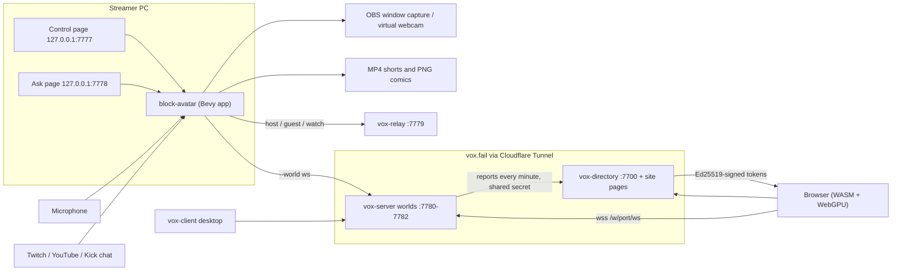
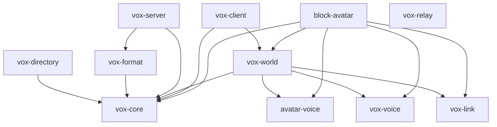

# System Overview

## Crates and dependencies

(Edges verified against each crate's `Cargo.toml` on 2026-11-26.)

- **vox-core** has no Bevy: block rules, wire format, token check, movement checks and weather are identical on server and clients. See `decisions/core-without-bevy`.
- **vox-world** (Bevy) draws a world and talks to a world server; shared by the app and the player client, native and WebAssembly.
- **vox-format** stores worlds as region blobs and snapshots (server side; decodes in wasm too).
- **vox-link** keeps a WebSocket open on its own thread with backoff (desktop only).
- **avatar-voice** is the pure-Rust voice analysis (lip sync, pitch, formants) used by the avatar app and by `vox-world` for mouths.
- **vox-voice** is the pure-Rust voice transport: IMA ADPCM, resampler, jitter buffer, packetizer. `vox-world` (world voice chat) and `block_avatar` use it; no engine, wasm-safe.
- **vox-relay** knows nothing about Vox types; it forwards bytes and lists shows.
- Services are small axum servers; each keeps state in SQLite (worlds also keep snapshot files).

## Ports
| Port | Service | Exposure |
| --- | --- | --- |
| 7777 | Avatar control page | localhost only, no login |
| 7778 | Viewer "ask" page | localhost; public only through the streamer's own tunnel |
| 7779 | vox-relay | any; put behind TLS |
| 7700 | vox-directory (also serves the site) | localhost behind Cloudflare Tunnel |
| 7780 / 7781 / 7782 | The Void / yard / islands | localhost behind the tunnel at `/w/<port>/ws` |
| UDP 39539, 49983 | Face capture (VMC, iFacialMocap) | localhost |

## Trust boundaries
- The directory signs tokens; worlds hold only the public key. A token is valid on any world (no audience yet).
- Worlds report to the directory with a shared secret (`VOX_WORLD_SECRET`) over localhost; `/api/world/*` must never be public (the tunnel config refuses them).
- The server no longer trusts reported positions blindly (`vox-core::moves`).
- The avatar control page trusts any local process; the ask page is the only streamer-side surface meant for the internet.

See `architecture/avatar-app-runtime`, `architecture/vox-server`, `architecture/vox-directory`, `architecture/wire-protocol`, `architecture/deployment`.

# Related Concepts
- [Block Avatar Runtime: Bevy Schedule, Threads and State](avatar-app-runtime.md): how the avatar app runs
- [vox-core: Shared Rules, Wire Format and Tokens](vox-core.md): shared rules crate
- [vox-world: Drawing a World (Blocks, Sky, Portals, Players)](vox-world.md): world rendering crate
- [vox-server: One Persistent World](vox-server.md): world server
- [vox-directory: Accounts, Characters, Economy and Web Pages](vox-directory.md): accounts and economy service
- [vox-client and the Web Front End](vox-client-and-web.md): player client and site
- [Shows over the Network: Relay, Host, Guest and Viewers](show-networking.md): relay, host, guest, viewers
- [Deployment: vox.fail on Cloudflare Tunnel, and Windows Packaging](deployment.md): how it is hosted and packaged
- [World Wire Protocol (PROTOCOL = 6)](wire-protocol.md): the world protocol
- [Identity, Sessions and Signed Launch Tokens](identity-and-tokens.md): sign-in and tokens
- [Asset Pipeline: MagicaVoxel to glTF](asset-pipeline.md): how assets are made
- [Testing and Continuous Integration](testing-and-ci.md): tests and CI
- [Design (phase 1 built): The World Format](world-format-design.md): how worlds are stored (vox-format)
